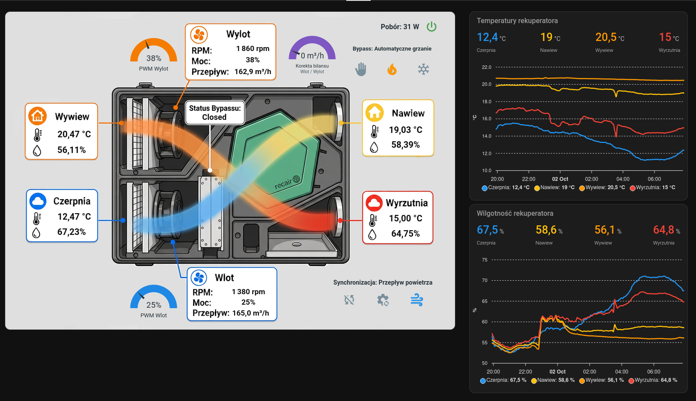

# OpenReku — karta Home Assistant

Karta `picture-elements` do sterowania rekuperatorem oraz wykresy temperatur, wilgotności, sprawności temperaturowej i odzysku wilgoci.

## Pliki

| Plik | Przeznaczenie |
| --- | --- |
| [karta_rekuperator.yaml](karta_rekuperator.yaml) | Konfiguracja karty do wklejenia w edytorze YAML panelu Home Assistant. |
| [karta_temperatury_sprawnosc_rekuperatora.yaml](karta_temperatury_sprawnosc_rekuperatora.yaml) | Karta z zakładkami „Temperatury” i „Sprawność”. |
| [karta_wilgotnosc_rekuperatora.yaml](karta_wilgotnosc_rekuperatora.yaml) | Karta z zakładkami wilgotności względnej (%) i zawartości wilgoci (g/kg suchego powietrza). |
| [rekuperator_sprawnosc_template.yaml](rekuperator_sprawnosc_template.yaml) | Sensory szablonowe HA obliczające sprawność temperaturową i odzysk wilgoci. |
| [karta_sprawnosc_rekuperatora.yaml](karta_sprawnosc_rekuperatora.yaml) | Samodzielny wykres sprawności jako alternatywa dla zakładki „Sprawność”. |
| [automations/test_filtrow.yaml](automations/test_filtrow.yaml) | Automatyzacja uruchamiająca codzienny test filtrów o 03:30. |
| [automations/korekta_bilansu_wyciag.yaml](automations/korekta_bilansu_wyciag.yaml) | Korekta bilansu nawiew/wywiew zależna od stanu wyciągu kuchennego. |
| [www/rekuperator2.jpg](www/rekuperator2.jpg) | Podkład graficzny karty z ilustracją rekuperatora i polami na odczyty. |

## Przykład



`karta_rekuperator.yaml` zawiera kartę z ilustracją po lewej stronie. Wykresy dodaje się jako osobne karty panelu; aktualne pliki mają przełączane zakładki.

## Instalacja

1. Dodaj urządzenie ESPHome do Home Assistant, aby udostępnić jego encje.
2. Zainstaluj dodatki [hui-element](https://github.com/thomasloven/lovelace-hui-element) i [Gauge Card Pro](https://github.com/benjamin-dcs/gauge-card-pro), np. przez HACS, zgodnie z ich instrukcjami. Karta używa `custom:hui-element` do osadzania wskaźników `custom:gauge-card-pro` i komunikatu trybu serwisowego.
3. Skopiuj `www/rekuperator2.jpg` do katalogu `www` konfiguracji Home Assistant, zwykle `/config/www/rekuperator2.jpg`. W YAML odpowiada mu ścieżka `image: /local/rekuperator2.jpg`. Jeśli tworzysz katalog `www` po raz pierwszy, uruchom ponownie Home Assistant. [Opis obsługi plików lokalnych](https://www.home-assistant.io/integrations/http/#hosting-files).
4. W edycji panelu dodaj kartę ręczną i wklej zawartość `karta_rekuperator.yaml`.
5. Dopasuj identyfikatory encji do swojej instalacji. Plik używa nazw z prefiksem `kotlownia_rekuperator_`; mogą się one różnić od nazw utworzonych przez Twoją integrację ESPHome.

## Wykresy i sensory sprawności

Karty wykresów wymagają dodatków **ApexCharts Card** i **Tabbed Card**. Każdy z plików `karta_temperatury_sprawnosc_rekuperatora.yaml` i `karta_wilgotnosc_rekuperatora.yaml` wklej jako osobną kartę ręczną w panelu. Samodzielna `karta_sprawnosc_rekuperatora.yaml` wymaga tylko ApexCharts Card.

Do zakładki „Sprawność” potrzebne są sensory z `rekuperator_sprawnosc_template.yaml`. Skopiuj plik do katalogu konfiguracji HA i dołącz w `configuration.yaml`:

```yaml
template: !include rekuperator_sprawnosc_template.yaml
```

Jeśli masz już sekcję `template:`, dołącz do niej zawartość pliku zgodnie z używanym układem konfiguracji, bez dodawania drugiego klucza `template:`. Dopasuj encje urządzenia we wszystkich nowych plikach, a następnie wczytaj ponownie encje szablonowe lub uruchom ponownie Home Assistant. Karty odwołują się do `sensor.rekuperator_sprawnosc_temperaturowa` i `sensor.rekuperator_odzysk_wilgoci`.

Sprawność jest liczona po stronie nawiewu: `(nawiew − czerpnia) / (wywiew − czerpnia) × 100%`, osobno dla temperatury i zawartości wilgoci. Wyniki są niedostępne przy wyłączonym urządzeniu, aktywnym teście serwisowym, zatrzymanym wentylatorze lub brakujących odczytach. Minimalna różnica między wywiewem a czerpnią wynosi 2°C dla temperatury i 0,5 g/kg dla wilgoci. Otwarcie bypassu nie wyłącza pomiaru, a wynik nie jest ograniczany do 0–100%.

Wykres wilgotności w g/kg korzysta z czterech sensorów `*_hum_abs` w ESPHome, wystawianych w HA jako `sensor.kotlownia_rekuperator_*_wilgotnosc_bezwzgledna`. Zielone pasma przedstawiają wybrany zakres 40–55% RH; pasmo 6,16–8,51 g/kg odpowiada mu przy 21°C i 1013,25 hPa.

## Test filtrów

W edytorze automatyzacji Home Assistant utwórz nową automatyzację i wklej w trybie YAML zawartość [test_filtrow.yaml](automations/test_filtrow.yaml). Godzina `03:30:00` odnosi się do strefy czasowej Home Assistanta.

Automatyzacja wywołuje `esphome.rekuperator_run_filter_test`. Jeśli urządzenie ma inną nazwę, wybierz odpowiadającą mu akcję `run_filter_test`. Procedurę pomiarową wykonuje ESPHome.

## Wyciąg kuchenny

Wklej [korekta_bilansu_wyciag.yaml](automations/korekta_bilansu_wyciag.yaml) jako osobną automatyzację w edytorze YAML. Ustawia korektę bilansu na `30` przy włączonym wyciągu i na `0` przy wyłączonym.

Dopasuj encję wyciągu `switch.shelly1pm3_wentylator_switch_0` oraz encję korekty `number.kotlownia_rekuperator_korekta_bilansu_wlot_wylot` do swojej instalacji.

## Encje i obsługa

- Temperatury i wilgotności: czerpnia, nawiew, wywiew i wyrzutnia.
- Wentylatory: PWM, RPM i przepływ powietrza dla wlotu i wylotu.
- Synchronizacja: `Brak`, `Moc PWM` lub `Przepływ powietrza`, wraz z korektą bilansu.
- Bypass: stan zaworu oraz wybór `Ręczne sterowanie`, `Automatyczne grzanie` lub `Automatyczne chłodzenie`.
- Zasilanie i tryb serwisowy: po wyłączeniu zasilania karta jest przygaszona, a sterowanie zablokowane poza przyciskiem zasilania. Tryb serwisowy blokuje całą kartę i wyświetla komunikat.

Odczyt „Pobór” korzysta z osobnego licznika energii: `sensor.kotlownia_shellypmminig3_rekuperator_power`. Podmień tę encję na własny pomiar mocy albo usuń odpowiadający jej element `state-label`, jeśli nie używasz licznika.

Układ nakłada odczyty na konkretne miejsca podkładu. Przy zmianie grafiki zachowaj jej proporcje lub dopasuj pozycje `top` i `left` elementów.
