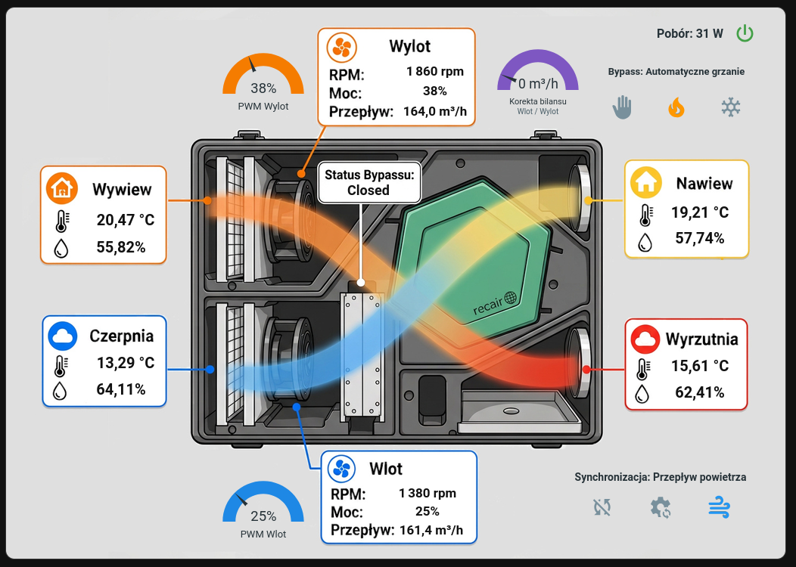

<picture>
  <source media="(prefers-color-scheme: dark)" srcset=".github/images/openreku-logo-white.svg">
  
</picture>

Otwarty projekt sterownika rekuperatora opartego na ESP32 i ESPHome, współpracującego z Home Assistant. Obejmuje elektronikę sterownika oraz konfigurację obsługującą wentylatory, zawory i czujniki.

## Funkcje sterownika

OpenReku steruje wentylacją nawiewno-wywiewną i udostępnia nastawy oraz pomiary w Home Assistant. Regulacja wentylatorów, automatyka bypassu i procedura testowa działają lokalnie w ESPHome. Urządzenie ma też własny panel WWW i obsługuje aktualizacje przez Wi-Fi.

- **Regulacja dwóch wentylatorów** — niezależne ustawianie wydajności nawiewu i wywiewu albo praca zsynchronizowana. Tryb „Moc PWM” ustawia obu wentylatorom jednakowy procent wysterowania. Tryb „Przepływ powietrza” dostosowuje wywiew do zmierzonego przepływu nawiewu, dzięki czemu uwzględnia różnice oporów obu torów powietrza.
- **Korekta bilansu nawiew–wywiew** — w trybie synchronizacji przepływu można ustawić żądaną różnicę w m³/h. Dodatnia korekta oznacza przewagę nawiewu; regulator uzyskuje ją przez zmniejszenie wywiewu rekuperatora. Dołączona automatyzacja Home Assistant zmienia korektę podczas pracy wyciągu kuchennego.
- **Ręczny lub automatyczny bypass** — tryby „Automatyczne grzanie” i „Automatyczne chłodzenie” porównują temperaturę powietrza z czerpni z temperaturą wywiewaną z domu. Bypass otwiera się, gdy powietrze zewnętrzne sprzyja wybranemu celowi, a zamyka, gdy korzystniejszy jest odzysk ciepła lub chłodu. Histereza i czas potwierdzenia warunku ograniczają częste przełączanie.
- **Podgląd parametrów pracy** — temperatury i wilgotności w czterech punktach: czerpni, nawiewie, wywiewie i wyrzutni, a także obroty obu wentylatorów i przepływy powietrza, zależnie od wyposażenia.
- **Test do obserwacji zużycia filtrów** — sterownik zamyka bypass, ustawia stałe wysterowanie wentylatorów i po ustabilizowaniu pracy uśrednia przepływ oraz obroty. Wyniki odniesione do nastawy PWM pozwalają porównywać kolejne pomiary; ostatni wynik jest zachowywany po restarcie. Na czas testu blokowane są zmiany nastaw, a po zakończeniu przywracane wcześniejsze ustawienia. Harmonogram zapewnia automatyzacja Home Assistant. Test dostarcza danych do oceny zmian, bez automatycznego alarmu wymiany filtra.

## Opis

Troche więcej o samym powstaniu projektu i co chciałem osiągnąć można przeczytać we [wpisie na mojej stronie](https://adrian.siemieniak.net/portal/sterownik-rekuperatora-cwk-450-o3zone-paruszewski/).

## Wyposażenie opcjonalne

Funkcje można dobrać do wyposażenia rekuperatora:

| Wariant / komponent | Dostępne funkcje |
| --- | --- |
| Dwa wentylatory ze sterowaniem PWM | Podstawowa regulacja niezależna lub wspólne wysterowanie w trybie „Moc PWM”, bez pomiaru przepływu. |
| Sygnały obrotów wentylatorów | Odczyt RPM i pomiary obrotów w procedurze testowej. Nie są wymagane do samego sterowania PWM. |
| Czujniki temperatury i wilgotności SHT4x | Monitoring do czterech torów powietrza. Temperatury czerpni i wywiewu służą automatyce bypassu, a nawiewu i wywiewu — obliczaniu przepływów. |
| Dwie zwężki Venturiego z czujnikami różnicy ciśnień SDP810-125Pa oraz pomiar temperatury nawiewu i wywiewu | Wyliczanie przepływów w m³/h, ich automatyczne bilansowanie i pomiary przepływu w teście filtrów. Obliczenia uwzględniają temperaturę powietrza oraz zadane wymiary zwężek. |
| Siłownik bypassu z osobnymi sygnałami otwierania i zamykania | Ręczne otwieranie i zamykanie, a z pomiarem temperatury czerpni i wywiewu także automatyczne grzanie lub chłodzenie. Czas ruchu jest ustawiany w konfiguracji; stan bypassu wynika z wydanych poleceń, bez pomiaru jego rzeczywistego położenia. |

Zamieszczony YAML odpowiada pełnemu zestawowi w instalacji autora. Warianty uproszczone wymagają dostosowania konfiguracji: usunięcia nieużywanych komponentów i zależnych od nich odczytów lub procedur. Nie ma automatycznego wykrywania wyposażenia ani gotowych profili tych wariantów.

## Zawartość repozytorium

| Katalog | Zawartość |
| --- | --- |
| [PCB/](PCB/) | Projekt płytki w wersji 1.1: schematy i PCB KiCad, lokalne biblioteki, lista elementów BOM, Gerbery do produkcji. |
| [ESPHome/](ESPHome/) | Konfiguracja `rekuperator.yaml` z obsługą urządzenia i integracją z Home Assistant oraz wzór `secrets.yaml.example` do uzupełnienia własnymi danymi dostępowymi. |
| [HomeAssistant/](HomeAssistant/) | Karta panelu Home Assistant, automatyzacje testu filtrów i korekty bilansu oraz podkład graficzny karty. |
| [Venturi/](Venturi/) | Model zwężki Venturiego do pomiaru przepływu powietrza: projekt FreeCAD i eksporty STEP obu części. |

Opis plików i instrukcję otwarcia projektu elektroniki zawiera [PCB/README.md](PCB/README.md). Przygotowanie konfiguracji i pliku sekretów opisano w [ESPHome/README.md](ESPHome/README.md). Sposób dodania karty do panelu opisano w [HomeAssistant/README.md](HomeAssistant/README.md).

## Licencja

Projekty PCB i mechaniki, dokumentacja i własne grafiki są udostępnione na licencji [CC BY-NC 4.0](LICENSES/CC-BY-NC-4.0.txt), a kod i konfiguracje YAML ESPHome oraz Home Assistant — na [PolyForm Noncommercial 1.0.0](LICENSES/PolyForm-Noncommercial-1.0.0.txt).

Możesz je kopiować, modyfikować i udostępniać do celów niekomercyjnych, na warunkach odpowiedniej licencji. Przy udostępnianiu zachowaj informację o autorze **Sauron**, nazwie **OpenReku**, [źródle projektu](https://github.com/Saur0o0n/OpenReku) i licencji; dla materiałów CC BY-NC oznacz również wprowadzone zmiany. Kod zawiera obowiązkową informację `Required Notice:`.

Zakres licencji i wyłączenia dotyczące cudzych materiałów określa [LICENSE](LICENSE). Wykorzystanie komercyjne wykraczające poza udzielone licencje wymaga osobnej zgody właścicieli praw.
