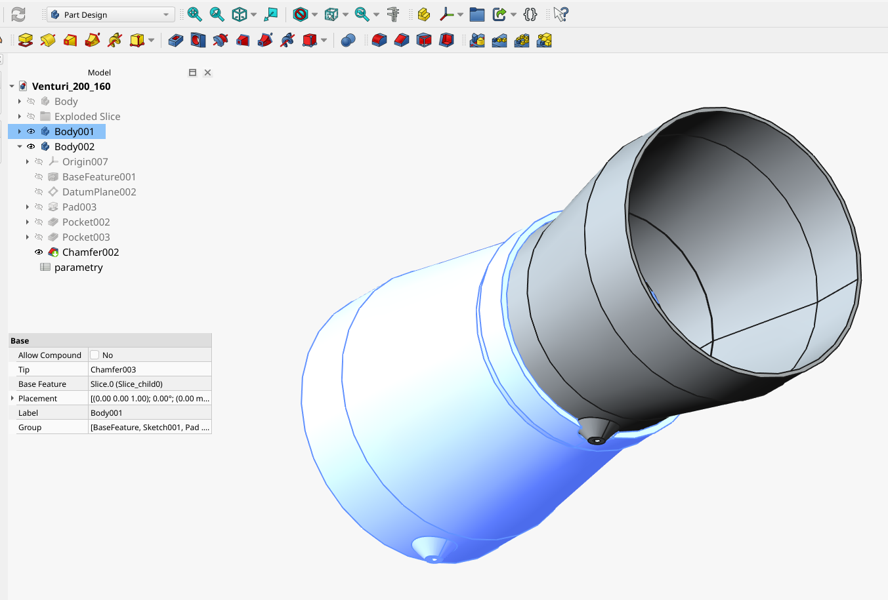

# Zwężka Venturiego

Model zwężki do pomiaru przepływu powietrza w rekuperatorze. Dwa króćce pomiarowe pozwalają doprowadzić ciśnienie z różnych przekrojów zwężki do czujnika różnicy ciśnień. Na tej podstawie konfiguracja ESPHome wylicza przepływ w m³/h, wykorzystywany do bilansowania nawiewu i wywiewu oraz testów filtrów.

## Pliki

| Plik | Przeznaczenie |
| --- | --- |
| [Venturi_200_160.FCStd](Venturi_200_160.FCStd) | Edytowalny projekt FreeCAD z historią modelowania i podziałem na dwie części. |
| [Venturi_200_160-Body001.step](Venturi_200_160-Body001.step) | Eksport części `Body001` w formacie STEP. |
| [Venturi_200_160-Body002.step](Venturi_200_160-Body002.step) | Eksport części `Body002` w formacie STEP. |

## Użycie w OpenReku

Do niezależnego pomiaru nawiewu i wywiewu stosuje się dwie zwężki, każdą z własnym czujnikiem różnicy ciśnień. Konfiguracja [ESPHome](../ESPHome/rekuperator.yaml) korzysta z czujników SDP810-125Pa i pomiarów temperatury powietrza.

Parametry `venturi_D_mm` i `venturi_d_mm` w YAML określają wewnętrzne średnice przepływu przed zwężeniem i w przewężeniu. Obecnie wynoszą odpowiednio 194 i 154 mm. Przy zmianie geometrii modelu należy dopasować je do wykonanej zwężki.

Projekt jest udostępniony na licencji [CC BY-NC 4.0](../LICENSES/CC-BY-NC-4.0.txt). Autor: **Sauron**, projekt [OpenReku](https://github.com/Saur0o0n/OpenReku).
